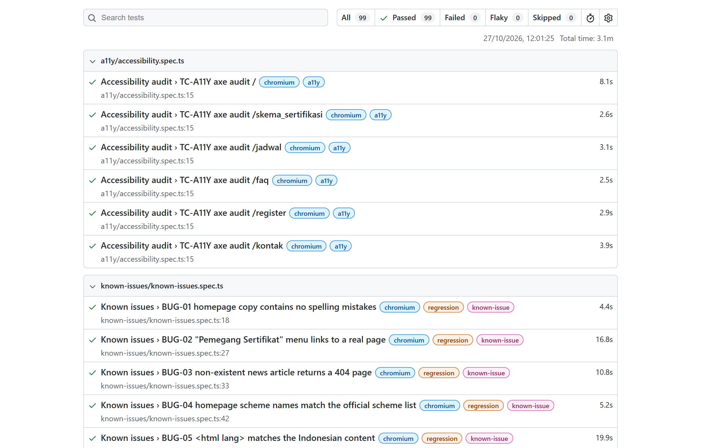
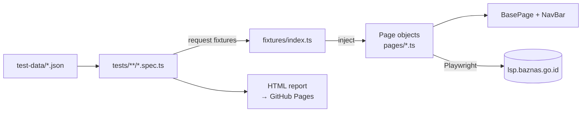
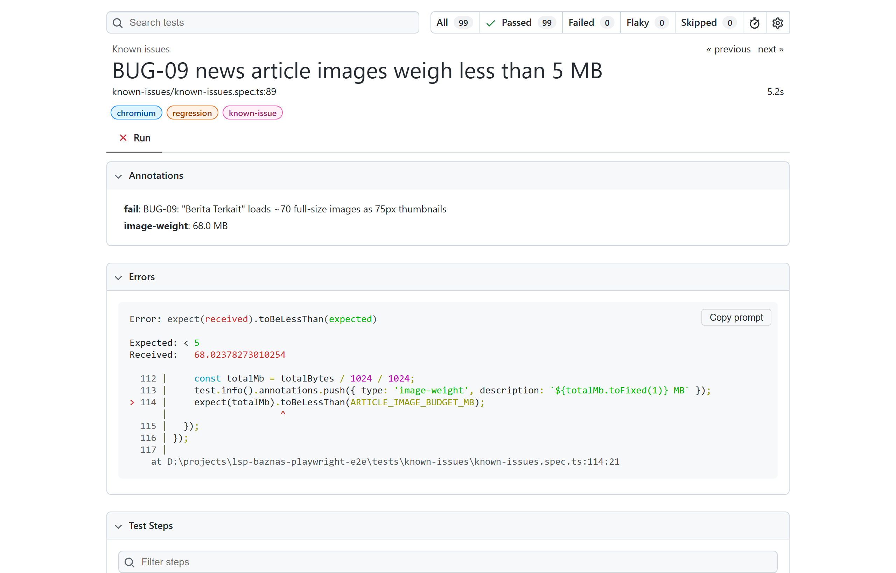

# LSP BAZNAS – Playwright E2E Test Suite

[](https://github.com/rezkyrevansyah/lsp-baznas-playwright-e2e/actions/workflows/playwright.yml)


End-to-end test automation for the public website of **LSP BAZNAS**
(Lembaga Sertifikasi Profesi Badan Amil Zakat Nasional): **https://lsp.baznas.go.id**.

📊 **Live test report:** https://rezkyrevansyah.github.io/lsp-baznas-playwright-e2e/
🐞 **Bug findings:** [docs/FINDINGS.md](docs/FINDINGS.md)

> **Production safety.** The tests run against **production**, so they are deliberately **read-only**: no form is ever submitted,
> no credentials are entered, no account is created, and traffic is kept low (1–2 workers, smoke-only
> cross-browser runs, weekly schedule). No load or security testing is performed.



## 📈 At a Glance

| Metric          | Value                                                                            |
| --------------- | -------------------------------------------------------------------------------- |
| Test cases      | **99**, which run as **139** executions across 4 browser projects                |
| Bugs found      | **9**, documented in [FINDINGS](docs/FINDINGS.md) and each one covered by a test |
| Biggest finding | One news article page downloads **~68 MB** of images and takes **~25 s** to load |
| Suites          | Smoke · Regression · Cross-browser · Mobile · Accessibility · Known issues       |
| CI              | GitHub Actions on push, PR, weekly schedule; report published to GitHub Pages    |

---

## ✨ Highlights

- **Page Object Model** with **custom fixtures**. Tests receive ready-made page objects, so specs read like test cases.
- **Data-driven tests.** Navigation and table checks are generated from JSON test data.
- **Cross-page data consistency.** Homepage statistics are checked against the real listing data.
- **Known-bug tracking with `test.fail()`.** 9 documented bugs stay green in CI and alert you when they get fixed.
- **Performance check without extra load.** BUG-09 blocks image downloads and measures image weight with `HEAD` requests.
- **Accessibility audit** with axe-core (WCAG 2.1 AA). Results are attached to the report.
- **Tags** (`@smoke`, `@regression`, `@mobile`, `@a11y`, `@known-issue`) for selective runs.
- **Quality gates in CI:** type check and Prettier format check run before the tests.

## 🧰 Tech Stack

| Tool                                                              | Purpose                                              |
| ----------------------------------------------------------------- | ---------------------------------------------------- |
| [Playwright Test](https://playwright.dev)                         | Test runner, browser automation, assertions, tracing |
| TypeScript                                                        | Type-safe test code                                  |
| [@axe-core/playwright](https://github.com/dequelabs/axe-core-npm) | Accessibility scanning                               |
| GitHub Actions + Pages                                            | CI pipeline and hosted HTML report                   |
| Prettier                                                          | Code formatting                                      |

## 🏗️ Architecture



- **Specs** describe behaviour only. They never contain raw selectors.
- **Page objects** own the selectors and the page-specific actions. `BasePage` holds what every page shares: open, heading, footer, navbar, and the broken-image check.
- **Fixtures** create the page objects, so a test just asks for `homePage`, `asesorPage`, `faqPage`, and so on.

## 🧪 Test Coverage

| #   | Area              | Spec                                  | What is verified                                                                                                | Tests |
| --- | ----------------- | ------------------------------------- | --------------------------------------------------------------------------------------------------------------- | ----- |
| 1   | Homepage          | `smoke/homepage.spec.ts`              | Intro, 4 stat counters, hero carousel, 6-step certification process, latest news, Login button                  | 6     |
| 2   | Navigation        | `smoke/navigation.spec.ts`            | Every dropdown link (data-driven) opens the right URL and page, plus Kontak and Home                            | 14    |
| 3   | Data tables       | `regression/data-tables.spec.ts`      | Asesor, Jadwal and TUK tables: headers, default rows, search, empty state, pagination, page length, data format | 20    |
| 4   | Data consistency  | `regression/data-consistency.spec.ts` | Homepage counters = asesor total, TUK total, scheme count                                                       | 3     |
| 5   | Content pages     | `regression/content-pages.spec.ts`    | Profil, Alur, Skema and Dokumentasi pages: status 200, heading, footer, no broken images                        | 9     |
| 6   | News              | `regression/berita.spec.ts`           | News list, article detail, pagination                                                                           | 3     |
| 7   | FAQ               | `regression/faq.spec.ts`              | 11 questions, first one open by default, expand, collapse, and one-open-at-a-time                               | 4     |
| 8   | Forms (no submit) | `regression/forms.spec.ts`            | Register fields, HTML5 validity, password toggle; Login UI; Contact form validation and map                     | 11    |
| 9   | Links & errors    | `regression/links-and-errors.spec.ts` | All internal homepage links return < 400; custom 404 page                                                       | 2     |
| 10  | SEO & page health | `regression/seo.spec.ts`              | Title, meta description, viewport, no uncaught JS errors                                                        | 7     |
| 11  | Known issues      | `known-issues/known-issues.spec.ts`   | 9 documented bugs (see [FINDINGS](docs/FINDINGS.md))                                                            | 9     |
| 12  | Accessibility     | `a11y/accessibility.spec.ts`          | axe-core WCAG 2.1 AA audit on 6 key pages                                                                       | 6     |
| 13  | Mobile            | `mobile/responsive.spec.ts`           | Hamburger menu, mobile dropdown, no horizontal scroll                                                           | 5     |

### Browser matrix

| Project         | Device          | Runs                        |
| --------------- | --------------- | --------------------------- |
| `chromium`      | Desktop Chrome  | Everything except `@mobile` |
| `firefox`       | Desktop Firefox | `@smoke`                    |
| `webkit`        | Desktop Safari  | `@smoke`                    |
| `mobile-chrome` | Pixel 7         | `@mobile`                   |

## 📁 Project Structure

```
.
├── .github/workflows/playwright.yml   # CI: checks → test → upload report → deploy to GitHub Pages
├── docs/
│   ├── FINDINGS.md                    # Bug report from exploratory testing
│   └── images/                        # Screenshots used in this README
├── fixtures/index.ts                  # Custom fixtures that inject page objects
├── pages/                             # Page Object Model
│   ├── components/NavBar.ts           #   shared header / navigation component
│   ├── BasePage.ts                    #   common behaviour (open, heading, broken images)
│   ├── HomePage.ts
│   ├── DataTablePage.ts               #   reusable for every DataTables listing
│   ├── ContentPage.ts
│   ├── BeritaPage.ts
│   ├── FaqPage.ts
│   ├── FormPage.ts                    #   base for form pages (HTML5 validity, never submits)
│   ├── RegisterPage.ts
│   ├── LoginPage.ts
│   └── KontakPage.ts
├── test-data/                         # JSON test data (navigation map, expected content)
├── tests/
│   ├── smoke/
│   ├── regression/
│   ├── known-issues/
│   ├── a11y/
│   └── mobile/
├── utils/helpers.ts
└── playwright.config.ts
```

### Example: fixture + page object

```ts
test('search filters rows by keyword', async ({ asesorPage }) => {
  await asesorPage.open();
  await asesorPage.search('Ahmad');
  await expect(asesorPage.info).toContainText('filtered from');
});
```

### Known-bug pattern

```ts
test('BUG-05 <html lang> matches the Indonesian content', async ({ page }) => {
  test.fail(true, 'BUG-05: lang="en" on Indonesian pages'); // expected to fail until fixed
  await page.goto('/');
  await expect(page.locator('html')).toHaveAttribute('lang', /^id/);
});
```

## 🧠 Design Decisions

| Decision                                                  | Why                                                                                                                                                                                           |
| --------------------------------------------------------- | --------------------------------------------------------------------------------------------------------------------------------------------------------------------------------------------- |
| Known bugs are tests that assert the **correct** result   | Wrapped in `test.fail()`, they keep CI green while the bug exists. When someone fixes the bug, the test passes unexpectedly and Playwright flags it, so the bug list never goes stale.        |
| Forms are checked with `checkValidity()`, never submitted | Production must stay clean: no fake accounts, no contact-form spam.                                                                                                                           |
| Image weight is measured with `HEAD` requests             | Measuring BUG-09 by downloading 68 MB on every CI run would add to the problem. Blocking the images and reading `content-length` keeps the check cheap.                                       |
| Waits target the element that matters                     | For example, `brokenImages()` waits only for images inside the given scope, and the FAQ helper waits for Bootstrap's collapse animation to finish. There are no fixed `waitForTimeout` calls. |
| Cross-browser runs are limited to `@smoke`                | Full coverage on Chromium, broad but shallow coverage on Firefox and WebKit, and less traffic to the production server.                                                                       |

## 🚀 Getting Started

**Prerequisite:** Node.js 20 or newer (22 recommended).

```bash
git clone https://github.com/rezkyrevansyah/lsp-baznas-playwright-e2e.git
cd lsp-baznas-playwright-e2e
npm ci
npx playwright install --with-deps
```

### Run

| Command                     | Description                              |
| --------------------------- | ---------------------------------------- |
| `npm test`                  | Full suite (all projects)                |
| `npm run test:smoke`        | Smoke tests on Chromium, Firefox, WebKit |
| `npm run test:regression`   | Full regression on Chromium              |
| `npm run test:mobile`       | Mobile tests (Pixel 7)                   |
| `npm run test:a11y`         | Accessibility audit                      |
| `npm run test:known-issues` | Known-bug tests only                     |
| `npm run test:headed`       | Watch the browser while tests run        |
| `npm run test:ui`           | Playwright UI mode                       |
| `npm run report`            | Open the last HTML report                |
| `npm run typecheck`         | TypeScript type check                    |
| `npm run format:check`      | Prettier check (`npm run format` fixes)  |

To test another environment, set `BASE_URL` (see `.env.example`):

```bash
BASE_URL=https://staging.example.com npx playwright test
```

## 🔄 CI/CD

The workflow in [`.github/workflows/playwright.yml`](.github/workflows/playwright.yml) runs on:

- every push and pull request to `main`
- a weekly schedule (Monday 08:17 WIB), as a health check of the live site
- manual trigger (`workflow_dispatch`)

Steps: install, type check, format check, install browsers, run tests, upload the report artifact,
then deploy the HTML report to **GitHub Pages**. Failed tests keep a trace, a screenshot and a video
for debugging. Only the deploy job gets the `pages: write` permission.

> To enable the hosted report, go to **Settings → Pages → Source** and choose **GitHub Actions**.

## 🐞 Findings Summary

Exploratory testing found **9 issues**, each covered by an automated test. Full details are in [docs/FINDINGS.md](docs/FINDINGS.md).

| ID     | Issue                                                  | Severity |
| ------ | ------------------------------------------------------ | -------- |
| BUG-01 | Spelling mistakes in homepage copy                     | Low      |
| BUG-02 | "Pemegang Sertifikat" menu is a dead link              | Medium   |
| BUG-03 | Invalid news ID shows "Whoops" error instead of 404    | Medium   |
| BUG-04 | Scheme names on homepage differ from the official list | Medium   |
| BUG-05 | `<html lang="en">` on Indonesian content               | Low      |
| BUG-06 | Non-unique page `<title>`s                             | Low      |
| BUG-07 | Empty `<h1>` on every page                             | Low      |
| BUG-08 | Broken image on the "Legalitas" page                   | Medium   |
| BUG-09 | News article pages download ~68 MB of images           | High     |

The known-issue tests record their evidence in the report. BUG-09, for example, stores the measured image weight as an annotation:



## 🛡️ Production Safety Rules

- Public pages only: no login and no authenticated areas.
- Forms are checked with `HTMLFormElement.checkValidity()` and are **never submitted**.
- Low concurrency, sequential link and image-size checks, and cross-browser runs limited to smoke tests.
- No load, stress, or security testing against production.

## 👤 Author

**Rezky Revansyah**, QA Automation Engineer

[](https://www.linkedin.com/in/rezkyrevansyah/)

## 📄 License

[MIT](LICENSE)
